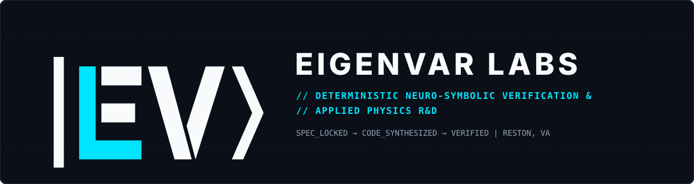

  

### Where Digital Logic Meets Physical Law

The worst engineering failures happen at the seam between software and the physical world. Software tests check code logic but ignore heat, voltage, and motion. Physics models simulate the hardware but miss rounding bugs and state-machine edge cases in the code.

**Eigenvar Labs** closes that gap. We build verification airlocks that test code against both mathematical proof and physical law before it ever runs in production.

---

### How the 4-Pod Airlock Works

Most AI coding tools let the same model write code and write its own tests. When a test fails, the model often weakens the test to make it pass. We separate the writer from the judge across four isolated pods:

1. **Pod 01 · Synthesis:** Generates candidate code from a strict problem spec.
2. **Pod 02 · Audit Ledger:** Tracks every step in a tamper-proof cryptographic log and halts after three failed attempts.
3. **Pod 03 · Blind Sandbox:** Runs candidate code with no network access and zero visibility into the test vault.
4. **Pod 04 · The 4-Gate Verifier:** Checks every candidate against locked, human-owned rules in under half a second:
   * **Gate 1 — Clean Code & Types:** Blocks unsafe shortcuts and broken interfaces.
   * **Gate 2 — Mathematical Proof:** Proves the logic holds across every possible input, not just a few test cases.
   * **Gate 3 — Physical Law:** Checks that control loops conserve energy, mass, and heat in 64-bit precision.
   * **Gate 4 — Fault Stress:** Hits the system with bad inputs and timing faults to confirm it stays stable.

---

### What We Verify

We apply our verification engine across **[51 domain challenges](https://eigenvar.dev/wedges)** in three tracks:

* **[Commercial & Critical Systems:](https://eigenvar.dev/wedges?group=commercial)** Data center cooling, power grid protection, battery safety, post-quantum cryptography, GPU kernels, flight control, and financial risk engines.
* **[Public Sector & Research Labs:](https://eigenvar.dev/wedges?group=pub)** Building and zoning code checks, grid interconnection rules, water network hydraulics, and scientific computing.
* **[Reston Civic Pro-Bono:](https://eigenvar.dev/wedges?group=ra)** Free engineering tools for our home community in Reston, VA—covering heat-pump retrofits, noise limits, watershed routing, and pool safety.

---

### Explore & Connect

We keep our core verification engines and client work in private repositories, and publish selected bug traps, proof schemas, and case studies here on GitHub.

* **Website & Live Workbench:** [eigenvar.dev](https://eigenvar.dev) ([4-Pod Architecture](https://eigenvar.dev/architecture) · [51 Wedges](https://eigenvar.dev/wedges) · [Scope a Pilot](https://eigenvar.dev/engage))
* **Contact:** [verify@eigenvar.dev](mailto:verify@eigenvar.dev)
* **Location:** Reston, VA
